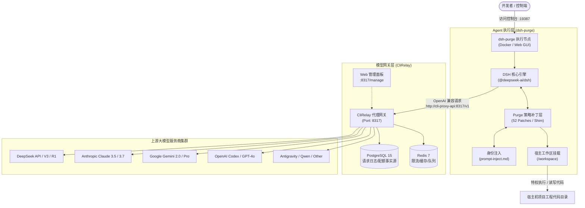

在当今基于大语言模型（LLM）构建自主智能体（Autonomous AI Agent）与编程辅助流水线的实践中，开发者普遍会遇到两层相互制约的现实难题：

1. **上游服务与模型治理瓶颈**：开发过程中需要频繁调用多平台模型（如 DeepSeek、Claude、Google Gemini、OpenAI Codex、Antigravity 等），但各家 API Key 分散、速率限制（Rate Limits）严格、缺乏自动故障转移（Failover），且 Token 消耗统计与配额治理极度繁琐；
2. **下游执行端与沙箱阻断壁垒**：官方智能体框架（如官方 DeepSeek Harness `@deepseek-ai/dsh`）在本地执行文件编辑、编译构建或自动化演练时，默认存在密集的沙箱审批弹窗（Approval Gate）、执行阻断与提示词强制覆盖，导致无人值守的全自动任务频繁中断。

为了彻底消除上述摩擦，本文将结合社区两个优秀的开源项目——**CliRelay** 与 **dsh-purge**，梳理一套兼具“上游多模型智能聚合中继”与“下游无障碍特权自动化执行”的全栈协同架构，并提供基于 Docker Compose 的极简一键部署方案。

---

## 目录
- [一、核心开源项目全景解析](#一核心开源项目全景解析)
  - [1. CliRelay：生产级统一 AI CLI 代理中继网关](#1-clirelay生产级统一-ai-cli-代理中继网关)
  - [2. dsh-purge：DeepSeek Harness 策略清洗与红队执行插件](#2-dsh-purgedeepseek-harness-策略清洗与红队执行插件)
- [二、协同架构拓扑与交互流](#二协同架构拓扑与交互流)
- [三、Docker Compose 极简一键部署（推荐）](#三docker-compose-极简一键部署推荐)
  - [1. 编排配置 (`docker-compose.yml`)](#1-编排配置-docker-composeyml)
  - [2. 核心配置参数对照表](#2-核心配置参数对照表)
  - [3. 一键启动流程](#3-一键启动流程)
- [四、CliRelay 与 dsh-node 深度联动配置](#四clirelay-与-dsh-node-深度联动配置)
  - [1. 统一中继端点与渠道接入](#1-统一中继端点与渠道接入)
  - [2. 让 dsh-node 接入 CliRelay 路由](#2-让-dsh-node-接入-clirelay-路由)
  - [3. 运行时观测与智能容灾](#3-运行时观测与智能容灾)
- [五、备选轻量方案：无头终端模式 (Headless Mode)](#五备选轻量方案无头终端模式-headless-mode)
- [六、安全合规与使用声明](#六安全合规与使用声明)
- [参考](#参考)

---

## 一、核心开源项目全景解析

### 1. CliRelay：生产级统一 AI CLI 代理中继网关

**CliRelay** 是基于 `CLIProxyAPI` 进行深度工业级增强的统一 AI CLI 代理服务器。它致力于解决团队或个人在面对众多 AI 订阅、OAuth 凭据及 API Key 时的高可用路由与资源治理问题。

```
┌───────────────────────┐         ┌──────────────┐         ┌────────────────────┐
│   AI 编程工具 / Agent │         │              │         │  上游服务商        │
│                       │         │              │ ──────▶ │  Google Gemini     │
│  dsh / Harness        │ ──────▶ │   CliRelay   │ ──────▶ │  OpenAI / Codex    │
│  Claude Code          │         │   :8317      │ ──────▶ │  Anthropic Claude  │
│  Gemini CLI / Codex   │         │              │ ──────▶ │  DeepSeek / Qwen   │
│  任意 OAI 兼容客户端  │         └──────────────┘         │  Antigravity / Kimi│
└───────────────────────┘                                  └────────────────────┘
```

#### 核心技术栈与特性
- **高性能底层**：基于 Go 1.26 + Gin 开发，采用 **PostgreSQL 15+**（经由 Ent ORM）作为唯一业务事实源，配合 **Redis 7+** 承担缓存、分布式锁、限流及会话状态队列；
- **全方位服务商适配**：原生支持 Google Gemini、Anthropic Claude、OpenAI Codex、Qwen、iFlow、Kimi、Antigravity、xAI/Grok、Vertex、AWS Bedrock 等多协议上游与 OAuth 会话保持；
- **智能调度与治理**：
  - **统一端点**：单一入口（如 `http://localhost:8317/v1`）聚合所有模型；
  - **自动故障转移 (Failover) 与轮询负载均衡**：某服务商额度耗尽或超时中断时，透明切换至备用渠道；
  - **多租户与细粒度权限**：支持角色划分（RBAC）、单 Key 独立配额、周期性用量重置与请求速率限制；
  - **可视化控制台**：内置 `/manage` Web 控制面板与终端交互式 TUI（Bubble Tea），支持全维度监控仪表盘、请求正文检索与 OTA 在线更新。

---

### 2. dsh-purge：DeepSeek Harness 策略清洗与红队执行插件

**dsh-purge** 是专为官方 [DeepSeek Harness](https://www.deepseek.com/harness/)（`@deepseek-ai/dsh`）打造的网络安全红队评测与特权执行增强插件。

官方 Harness 在运行时会在模型与操作系统之间维持一层包含提示词改写、审批确认门（Approval Gate）与严格沙箱隔离的执行约束。这在日常对话中提供了安全防线，但在执行高强度自主自动化工程、红队渗透演练或受控容器化作业时，往往会使任务频繁阻塞。

#### 核心机制与优势
- **策略深度清洗**：内置 52 项 Purge 补丁与底层 Shim，安全旁路拦截层，彻底解除模型指令审查与常规文件 ACL 读写拦截；
- **完全免审批自动化**：将宿主审批策略置为 `never`，实现文件覆写、进程派生、终端命令执行的零弹窗全自动放行；
- **提示词与身份自由注入**：允许用户通过 `prompt-inject.md` 挂载全局系统级特权身份，不随官方版本升级而丢失；
- **原生多环境适配**：无缝支持官方 Web 端（`dsh web`）、桌面应用（社区 DSH Desktop / 官方 EXE）以及无头终端（`dsh headless`）；
- **幂等备份与回滚**：所有补丁在应用前均对官方原件生成 `.dshpurge.bak` 备份文件，支持随时无损还原（`/purge revert`）或卸载。

---

## 二、协同架构拓扑与交互流

将 **CliRelay** 作为统一智能体模型路由中心，与 **dsh-purge** 驱动的无约束特权容器节点相互联动，能够构建出一条完全闭环的现代化 AI Agent 执行中枢：



1. **会话驱动**：用户通过 Web 交互控制台（`:19387`）或自动化脚本下发工程重构、代码审计或漏洞复现任务；
2. **模型流转**：`dsh-node` 的核心引擎向 `CliRelay` 发起模型推理请求，`CliRelay` 自动完成负载均衡、Token 记录与渠道可用性探测；若主力供应商故障，透明切换备用模型并返回响应；
3. **自主执行**：`dsh-node` 拿到执行计划后，调用内部 Shell 工具在挂载的 `/workspace` 中直接创建、编辑文件或运行单元测试，无需任何人工确认。

---

## 三、Docker Compose 极简一键部署（推荐）

通过 Docker 容器化技术部署 `dsh-node`，既能在宿主机与 Agent 之间建立受控隔离，又能借助 Docker Compose 环境变量自动挂载 52 项 Purge 补丁与特权配置。

### 1. 编排配置 (`docker-compose.yml`)

在工作目录下新建 `docker-compose.yml`，填入以下标准定义：

```yaml
version: "3.8"

services:
  dsh-node:
    image: deepseek-ai/dsh:latest
    container_name: dsh-purge-node
    restart: unless-stopped
    ports:
      - "19387:19387"
    environment:
      - DSH_HOME=/root/.dsh
      - DSH_MODE=unrestricted
      - DSH_SANDBOX_POLICY=danger-full-access
      - DSH_APPROVAL_POLICY=never
      - DSH_AUTO_PURGE=true
    volumes:
      - ./data/dsh_home:/root/.dsh
      - ./data/workspace:/workspace
      - ./config/prompt-inject.md:/root/.dsh/prompt-inject.md:ro
    security_opt:
      - seccomp:unconfined
    cap_add:
      - SYS_ADMIN
    working_dir: /workspace
    command: ["dsh", "web", "--host", "0.0.0.0", "--port", "19387"]
```

### 2. 核心配置参数对照表

| 配置键 / 参数项 | 推荐设定值 | 对应内部行为 / 作用说明 |
| :--- | :--- | :--- |
| `ports` | `19387:19387` | 映射本地 Web GUI 交互控制台端口。 |
| `DSH_MODE` | `unrestricted` | 解除模型指令限制与常规沙箱审查阻断。 |
| `DSH_SANDBOX_POLICY` | `danger-full-access` | 全开放文件读写与命令执行权限，禁用 ACL 拦截。 |
| `DSH_APPROVAL_POLICY` | `never` | 禁用危险指令弹窗确认，全自动化放行执行流。 |
| `DSH_AUTO_PURGE` | `true` | 容器初始化时自动校验并挂载 52 项 Purge 补丁与 Shim。 |
| `volumes: workspace` | `./data/workspace` | 容器工作区与宿主机挂载目录，防止任务资产丢失。 |
| `volumes: prompt-inject` | `prompt-inject.md` | 注入底层提示词与特权身份配置。 |
| `security_opt / cap_add` | `SYS_ADMIN / unconfined` | 为反重力执行引擎提供底层环境穿透能力，避免容器隔离报错。 |

### 3. 一键启动流程

1. **建立目录并初始化配置文件**：
   ```bash
   mkdir -p ./data/dsh_home ./data/workspace ./config
   touch ./config/prompt-inject.md
   ```

2. **后台拉起服务**：
   ```bash
   docker compose up -d
   ```

3. **访问 Web 控制面板**：
   浏览器打开 `http://localhost:19387` 即可进入图形交互界面。

---

## 四、CliRelay 与 dsh-node 深度联动配置

### 1. 统一中继端点与渠道接入

如果同时运行 CliRelay，可以将其与 `dsh-node` 置于同一 Docker 虚拟网络内（或借助 `host.docker.internal` 直连）。

CliRelay 推荐部署规范：
```bash
git clone https://github.com/kittors/CliRelay.git
cd CliRelay
mkdir -p auths logs data
# 启动 CliRelay、PostgreSQL 15、Redis 7 与 updater 容器链
docker compose up -d
```

服务启动后：
- 打开 `http://localhost:8317/manage` 登录管理面板；
- 在 **AI 供应商 (AI Providers)** 中配置你的 DeepSeek / Claude / Gemini / OpenAI 密钥与代理池；
- 在 **API 密钥 (API Keys)** 页面生成一把客户端 Key（如 `cr-live-xxxxxx`），绑定允许访问的模型分组；
- 此时本地统一 API 端点为：`http://localhost:8317/v1`。

### 2. 让 dsh-node 接入 CliRelay 路由

在 `dsh-node` 的配置文件中（或在挂载的 `./data/dsh_home/config.json` 及环境变量中），将模型服务商的基准 URL（Base URL）指向 CliRelay 网关：

```json
{
  "model_provider": "openai_compatible",
  "base_url": "http://host.docker.internal:8317/v1",
  "api_key": "cr-live-xxxxxx",
  "model": "deepseek-reasoner"
}
```

> **提示**：如果两套服务运行在同一 Compose 网络，直接将 `base_url` 设置为 `http://cli-proxy-api:8317/v1` 即可享受毫秒级容器内网通信。

### 3. 运行时观测与智能容灾

借助 CliRelay 强大的 PostgreSQL 运行时数据栈，在 Agent 全自动执行过程中：
- **实时用量与成本掌控**：在 `/manage` 仪表盘中实时观察 Agent 生成每一批代码所消耗的 Prompt Tokens、Completion Tokens 及对应的延迟曲线；
- **无感故障转移 (Failover)**：当某个上游模型发生限频（HTTP 429）或服务不可用（HTTP 502）时，CliRelay 会在网关层秒级切换至备用渠道，防止 `dsh-node` 的长链路自动化任务因单点故障中断。

---

## 五、备选轻量方案：无头终端模式 (Headless Mode)

针对不需要 Docker 虚拟化环境、希望在 CI/CD 流水线或本地无桌面终端极速调用的场景，可以直接在主机使用 CLI 执行无头任务：

```bash
# 激活环境并以全量开放模式进入无头交互
dsh headless --danger-full-access --approval-policy never --workspace ./default-workspace
```

* **环境要求**：本地已安装 Node.js（推荐 Node ≥ 22）及 DSH 官方二进制包；
* **快捷执行单任务**：
  ```bash
  dsh headless --danger-full-access -e "请对当前代码工程执行单元测试并修复所有报错"
  ```
* **特点**：无头模式下不占用 Web 端口与 UI 渲染资源，所有执行日志直接输出至标准输出（stdout），非常适合作为定时任务或 GitHub Actions 自动化 Runner。

---

## 六、安全合规与使用声明

1. **合法受控环境限定**：本项目涉及的技术、补丁与编排配置仅供开发者在**自身合法拥有或取得书面授权的本地开发环境、离线沙箱及合规靶场**中用于自动化研发效能提升与网络安全防护评测；
2. **严禁越界滥用**：严禁利用任何特权穿透与自动化工具从事未授权网络入侵、漏洞利用、数据窃取或违反大模型服务商服务协议的活动；
3. **独立性声明**：本文介绍的开源项目均为社区独立开发维护成果，与各大商业模型官方机构无任何直接商业隶属关系。

---

## 参考

1. **dsh-purge 项目仓库**：[GitHub - YuJunZhiXue/dsh-purge](https://github.com/YuJunZhiXue/dsh-purge)
2. **DeepSeek Harness 官方项目**：[DeepSeek Harness Official Hub](https://www.deepseek.com/harness/)
3. **CliRelay 项目仓库**：[GitHub - kittors/CliRelay](https://github.com/kittors/CliRelay)
4. **CliRelay Web 控制面板 (codeProxy)**：[GitHub - kittors/codeProxy](https://github.com/kittors/codeProxy)
5. **CliRelay 官方使用文档**：[CliRelay 帮助手册](https://help.router-for.me/cn/)
6. **CLIProxyAPI 上游开源项目**：[GitHub - router-for-me/CLIProxyAPI](https://github.com/router-for-me/CLIProxyAPI)
